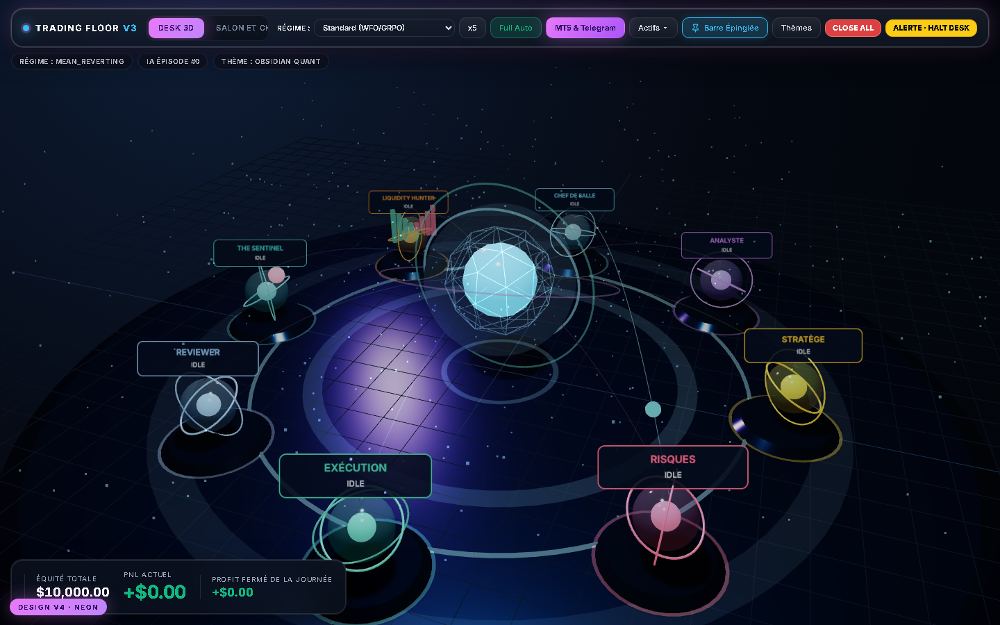
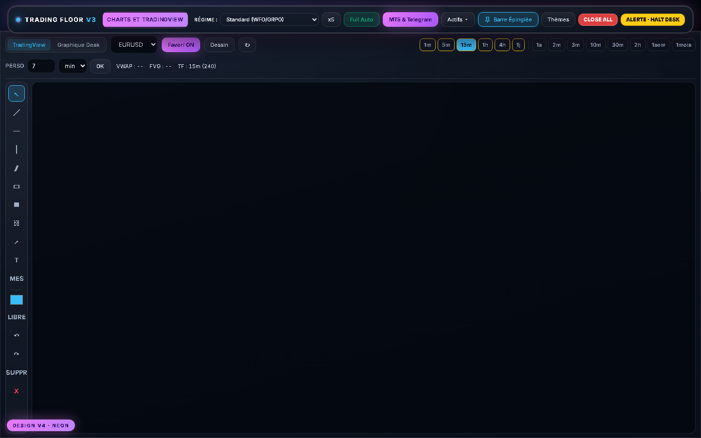

# Trading Floor Desk — Quant Multi-Agents & MetaTrader 5

Plateforme de trading algorithmique autonome **locale** (Paper Trading & exécution synchronisée sur **MetaTrader 5** via Expert Advisor MQL5), orchestrée par **8 agents temps réel + 1 méta-stratège asynchrone (`Strategy_Optimizer`)**, un moteur **Smart Money Concepts (SMC)** Python/Pydantic (`smartmoneyconcepts`) + TypeScript, une gouvernance quantitative en **4 Modules (TCA, XAI, ATR/Half-Kelly, Outer-Loop)**, un accès **mobile sécurisé (Cloudflare Tunnel + PIN + QR Code)** et des notifications/commandes **Telegram**.

---

## Aperçu visuel

### Salle de marché 3D & HUD minimaliste


### Graphiques plein écran & TradingView


### Stratégie, gestion du risque & apprentissage GRPO


---

## Architecture générale du Desk

1. **Collecte de marché & Multi-Timeframes (`src/market.ts`, `src/mt5.ts`)**
   - **Forex & Métaux (`EURUSD`, `GBPUSD`, `USDJPY`, `USDCHF`, `AUDUSD`, `USDCAD`, `NZDUSD`, `XAUUSD`, `XAGUSD`)** : cotations temps réel MT5 + séries historiques multi-UT (`5m` ~1 400 barres, `15m` ~450 barres, `1h` ~540 barres).
   - *(Les actifs Crypto sont désactivés pour compatibilité stricte `MetaQuotes-Demo` où `cryptoSupported = false`.)*
2. **Moteur Technique & Quantitatif (`src/agents/smcEngine.ts`, `scripts/smc_engine.py`, `src/agents/marketProfile.ts`, `src/backtest.ts`, `src/agents/traderSkills.ts`)**
   - **Smart Money Concepts (SMC)** : détection `CHoCH` / `BOS`, `Order Block` adossé à un `Fair Value Gap (FVG)`, `Liquidity Sweeps (BSL/SSL)` et retracement / mitigation dans la zone POI.
   - **Market Profile** : calcul dynamique `POC`, `VAH`, `VAL` et détection réelle de régime `RANGE` vs `TREND`.
   - **Validation statistique double** : **Walk-Forward Purgé (WFO IS/OOS)** avec embargo et coûts de friction + **Simulation Monte Carlo TimeMachine (2 500 trajectoires)** avant toute annonce de setup.
3. **Pont d'Exécution MT5 (`src/mt5.ts`, `TradingFloorBridge.mq5`)**
   - Synchronisation fichier JSON isolée (`MQL5/Files/trading_floor_bridge.json` & `mt5_state.json`), bail maître multi-graphiques (`EnsureMaster` 15s), pose systématique de **Hard SL / Hard TP** côté broker et modification asynchrone (`OrderModify`) pour le Break-Even et le Trailing.
4. **Pilotage & Mobilité (`src/server.ts`, `src/auth.ts`, `src/services/telegramDesk.ts`, `scripts/start-tunnel.mjs`)**
   - Géré par **PM2** (`ecosystem.config.cjs`) : processus `trading-desk` (`:4080`) + `trading-desk-tunnel` (`cloudflared` HTTPS).
   - Authentification distante par `DESK_ACCESS_PIN` (cookie HMAC signé), **QR Code scannable** directement depuis le Desk PC, et vue mobile épurée `< 768px` (Three.js WebGL désactivé pour préserver la batterie).

---

## Fonctionnement détaillé des 9 Agents

### 01 · Desk Lead (`src/agents/deskLead.ts`)
- **Rôle** : Chef de salle et orchestrateur des cycles de scan, de l'objectif journalier (`SessionGoalManager`) et du pacing (`PacingCalculator`).
- **Fonctionnement** : Lance les scans, vérifie l'état de pause (`halted`), applique les réglages de cadence et coordonne le passage de relais entre Analyste, Stratège, Directeur des Risques et Trader d'Exécution.

### 02 · Analyste Marché & Recherche (`src/agents/analyst.ts`)
- **Rôle** : Contexte fondamental, macroéconomique et sentiment.
- **Fonctionnement** : Agrège les événements macro (`MacroScore` entre `-1` et `+1`), bloque les signaux allant frontalement contre un choc macro (`allowsDirection`) et publie les données de marché brutes sans jamais proposer de trade seul.

### 03 · Stratège Quant (`src/agents/strategist.ts` + `src/desk.ts`)
- **Rôle** : Génération, filtrage et validation des setups.
- **Fonctionnement** :
  - Priorise le moteur **SMC (`Macro_FVG_Mitigation`)** : exige la confluence `CHoCH/BOS` + `Order Block` adossé à un `FVG` + `Mitigation` (et `Liquidity Sweep`).
  - Utilise le **Market Profile (`POC`/`VAH`/`VAL`)** pour interdire les achats au-dessus du `VAH` / ventes sous le `VAL` en range non cassé.
  - Exécute les **15 Trader Skills** (Opening Range Breakout `ORB`, `EntryTimer`, `StructuredExitPlan`), puis valide **WFO Purgé** + **TimeMachine (2 500 sims)** **avant** d'annoncer un setup valide.
  - Adapte le couple SL/TP au mode choisi (`Day Trading 1h/15m` à `2.2R`, `Scalping 5m/15m` plafonné à `<= 1.8× ATR(5m)` / `1.35–1.65R`, `Swing 4h` à `2.5R`).

### 04 · Directeur des Risques (`src/agents/riskManager.ts` + `src/lotSizing.ts`)
- **Rôle** : Dimensionnement dynamique du capital et coupe-circuits.
- **Fonctionnement** :
  - **Lot Sizing basé sur l'équité réelle** : `RiskAmount = AccountEquity × RiskPercent` (`0.5%` à `1%` par défaut, modulé par Fractional Half-Kelly), `LotSize = RiskAmount / (SL_Points × TickValuePerPoint)`, normalisé sur `VolumeMin` / `VolumeStep` / `VolumeMax` du broker avec plafond `MAX_LOT_CAP`.
  - **Concurrence Multi-Paires (`calculateDynamicConcurrency`)** : débloque de `1` à `5` positions simultanées selon le profil (`maxConcurrentPositions`) tout en vérifiant la marge disponible.
  - **Garde-fous** : Liquidation Guard (`15%`), plafond de perte journalière (`5%`), cooldown directionnel anti-death-loop après SL et **Auto-Critique Pré-Trade** (refus de réouvrir au même prix après TP ou à contre-tendance après perte).

### 05 · Trader d'Exécution & ActiveTradeManager (`src/agents/executionTrader.ts`, `src/agents/activeTradeManager.ts`)
- **Rôle** : Routage des ordres vers MT5 et gestion active des positions ouvertes.
- **Fonctionnement** :
  - Garantit des bornes **Hard SL / Hard TP** sur chaque ordre envoyé à MT5.
  - **Sortie structurelle autonome (`evaluateAgentStructuralExit`)** : après un délai minimum anti-bruit (`90s` en scalping, `5 min` en daytrade/swing), encaisse le profit dès `>= 45%` du TP si une borne `VAH`/`VAL` est touchée ou si un **`CHoCH` inverse** apparaît, et coupe préventivement si un `CHoCH` inverse complet (`validSignal`) invalide la thèse.
  - **Break-Even Adaptatif (50%–90%) & Ratchet** : remonte automatiquement le Hard SL en profit net (frais couverts) via `OrderModify` asynchrone dès que le trade progresse vers sa cible.

### 06 · Trade Reviewer / Auditeur (`src/agents/reviewer.ts`)
- **Rôle** : Audit individuel de chaque trade et gouvernance cognitive.
- **Fonctionnement** :
  - Journalise chaque trade clôturé dans le blotter (`blotter.jsonl`) et produit un post-mortem (`trade_post_mortem.json`).
  - Produit les rapports de gouvernance **Module 1 (TCA — Implementation Shortfall, slippage bps)**, **Module 2 (XAI — délibération contradictoire *Disagree-or-Commit* avec traces SMC)** et **Module 4 (Outer-Loop EOD — mise à jour Half-Kelly & régime)**.
  - Met à jour la politique RL **GRPO** (`src/rl/grpo.ts`).

### 07 · The Sentinel SRE (`src/agents/sentinel.ts`)
- **Rôle** : Fiabilité opérationnelle et latence.
- **Fonctionnement** : Surveille le RTT des API publiques (suspend le HFT market si `> 150 ms` sur 3 ticks), gère le Token Bucket de débit et protège l'intégrité du capital (halt sécurisé sans crash).

### 08 · Liquidity Hunter (`src/agents/liquidityHunter.ts`)
- **Rôle** : Microstructure & aimants de liquidité.
- **Fonctionnement** : Sur les flux disposant d'un carnet L2 réel, détecte le spoofing (`< 500 ms`), les déséquilibres Bid/Ask, les squeezes Funding/OI et les zones d'aimants de liquidité pour affiner les Take Profits.

### 09 · Strategy_Optimizer — Méta-Stratège (`src/agents/strategyOptimizer.ts`)
- **Rôle** : Optimisation globale asynchrone (tâche de fond séparée du Reviewer).
- **Fonctionnement** : Se déclenche tous les `N` trades clôturés (`OPTIMIZER_EVERY_N_TRADES=10`) et en fin de journée (`OPTIMIZER_EOD_HOUR=22`). Analyse Win Rate, Profit Factor, Drawdown et PnL par paire/timeframe, met en quarantaine les paires toxiques, écrit `strategy_adjustments.json` avec historique versionné (`history/vNNNN.json` avec **rollback** possible) et ajuste dynamiquement les paramètres du Stratège et du Risk Manager.

---

## Les 3 Modes de Stratégie (Onglet Paramètres)

L'onglet **Stratégie / Paramètres** laisse les agents et `Strategy_Optimizer` piloter les constantes fines, autour de **3 profils cliquables en 1 clic** :
1. **Day Trading Institutionnel (Recommandé)** : `1h / 15m` (`SMC + WFO`), cible `2.2R`, concurrence `3` positions simultanées.
2. **Scalping Multi-Paires (`5m / 15m`)** : flux `5m` (~1 400 bougies) + `15m`, SL borné à `<= 1.8× ATR(5m)`, cible `1.35–1.65R`, concurrence débloquée jusqu'à **`5` positions simultanées** sur paires décorrélées.
3. **Swing Macro SMC (`4h`)** : `4h / 1h`, cible `2.5R`, concurrence `3` positions simultanées.

---

## Avantages du système

- **Discipline institutionnelle complète** : aucun trade ne passe sans confluence technique (`SMC` + `Market Profile`), validation statistique hors-échantillon (`WFO Purgé` + `TimeMachine`), débat contradictoire (`Disagree-or-Commit` XAI) et dimensionnement dynamique (`ATR` + `Half-Kelly`).
- **Protection multi-couches du capital** : Hard SL/TP côté broker MT5, Break-Even adaptatif `50–90%`, sortie structurelle anti-bruit sur `CHoCH` inverse, cooldown directionnel après perte et coupe-circuits journaliers.
- **Auto-adaptation continue** : l'auto-audit cognitif post-clôture, `GRPO` et `Strategy_Optimizer` ajustent les paramètres sans intervention manuelle.
- **Contrôle & mobilité 100% locaux** : pas de SaaS tiers payant ; accès mobile HTTPS via Cloudflare Tunnel + PIN + **QR Code** et pilotage Telegram (`/status`, `/agents`, `/pause`, `/resume`).

---

## Inconvénients & Limites actuelles

- **Pas de HFT à la milliseconde** : le pipeline HTTP Yahoo + Python SMC + WFO + pont fichier JSON MT5 prend ~300 ms à 1 s par actif ; il est adapté au Day Trading et au Scalping `5m/15m`, pas au *tick-scalping* sub-seconde.
- **Coût du spread MT5 en mode Scalping** : sur compte Demo/Retail, descendre sous `5m` réduit le ratio gain/spread ; multiplier les trades trop courts sur de petits mouvements peut dégrader l'espérance nette.
- **Source historique Forex/Métaux via Yahoo Finance** : Yahoo limite l'historique `5m`/`15m` à `5 jours` (~450 bougies `15m`) et ne fournit ni carnet d'ordres L2 ni volume tick réel sur le Forex (repli TPO pour le Market Profile, `Liquidity Hunter` L2 inactif sur FX).
- **Dépendance au poste local** : l'exécution MT5 et le tunnel Cloudflare nécessitent que le PC et MetaTrader 5 restent allumés et connectés.
- **URL Quick Tunnel volatile sans token fixe** : sans `CF_TUNNEL_TOKEN`, Cloudflare génère une nouvelle URL `*.trycloudflare.com` à chaque redémarrage du tunnel (compensé par le QR Code dynamique sur le Desk PC).

---

## Horizons d'amélioration (Roadmap)

1. **Flux bougies `M1` / `M5` & ticks natifs depuis MetaTrader 5** : faire exporter directement par `TradingFloorBridge.mq5` les 500 dernières bougies `M1`/`M5` et le spread réel dans `mt5_state.json` pour s'affranchir de Yahoo Finance et réduire la latence à `< 100 ms`.
2. **Hébergement VPS Windows + Tunnel Cloudflare nommé (`CF_TUNNEL_TOKEN`)** : exécution 24/5 près du serveur broker avec URL HTTPS mobile fixe.
3. **Base de données SQLite / PostgreSQL dédiée** : remplacer `state.json` et `blotter.jsonl` pour conserver plusieurs années d'historique TCA, XAI et métriques par session sans alourdir la sérialisation JSON.
4. **Filtre de corrélation de portefeuille en temps réel** : éviter d'ouvrir simultanément 3 paires fortement corrélées au USD (ex. `EURUSD` + `GBPUSD` + `AUDUSD` dans le même sens) lorsque la concurrence multi-paires (`3–5`) est active.
5. **Calendrier économique temps réel automatisé** : brancher un flux calendrier (NFP, CPI, FOMC, BCE) pour activer automatiquement `VOLATILITY_SHIELD` avant les annonces à fort impact.

---

## Installation & Commandes

### Prérequis
- **Node.js >= 23.6**
- **Python 3.11+** avec `.venv` (`smartmoneyconcepts`, `pandas`, `pydantic` — voir `requirements.txt`)
- **MetaTrader 5** (avec l'EA `TradingFloorBridge.mq5` actif sur un graphique)
- **PM2** (`npm i -g pm2`) et **cloudflared** (pour le tunnel mobile)

### Commandes principales
```powershell
npm install
npm run typecheck
npm test

# Lancement en production avec PM2 (Desk :4080 + Tunnel HTTPS mobile)
pm2 start ecosystem.config.cjs --update-env
pm2 logs trading-desk
```

### Variables clés (`.env`)
Voir [.env.example](.env.example) pour la liste complète : `RISK_BASED_SIZING`, `RISK_PERCENT`, `MAX_LOT_CAP`, `OPTIMIZER_EVERY_N_TRADES`, `TELEGRAM_BOT_TOKEN`, `TELEGRAM_CHAT_ID`, `DESK_ACCESS_PIN`, `CF_TUNNEL_TOKEN`.
