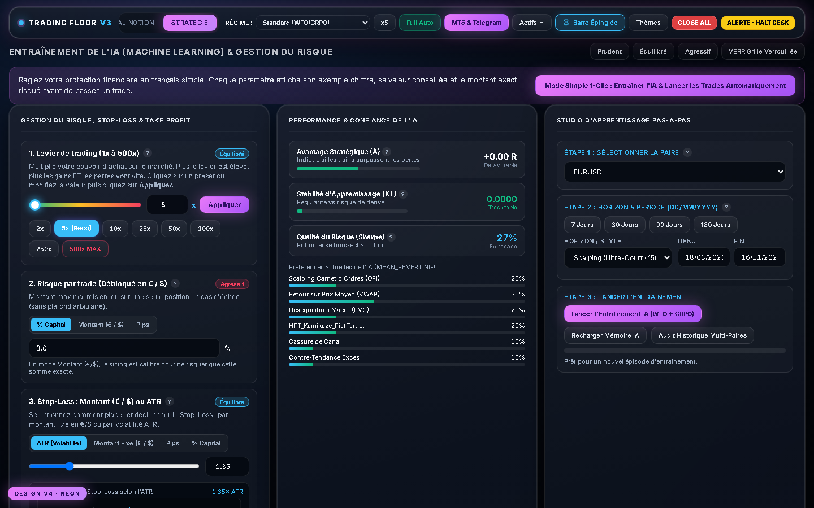

# Trading Floor Desk V5

Plateforme de trading algorithmique autonome **100 % locale** (Paper Trading & passerelle MetaTrader 5), orchestrée par **8 agents quantitatifs spécialisés**, dotée d'une salle de marché 3D interactive à 60 fps et compatible avec **OpenWork**.

---

## Aperçu visuel

### Salle de marché 3D & HUD minimaliste


### Graphiques plein écran & TradingView


### Stratégie, gestion du risque & apprentissage GRPO


---

## Architecture des 8 Agents Institutionnels

| Agent | Rôle principal | Logique implémentée |
| :--- | :--- | :--- |
| **Desk Lead** (`src/agents/deskLead.ts`) | Orchestration & Objectifs | Gestion de session chronométrée (`PacingCalculator`), détection d'Alpha Decay et modulation dynamique de l'appétit au risque. |
| **Market & Research Analyst** (`src/agents/analyst.ts`) | Macro & Sentiment | Parsing des flux macro-économiques JSON et sentiment social pour calculer un `MacroScore` (`-1` à `+1`) filtrant les trades à contre-tendance. |
| **Quant Strategist** (`src/agents/strategist.ts`) | Signaux & Symétrie | Itération round-robin multi-actifs, symétrie stricte LONG/SHORT, cooldown de 5 min par symbole après clôture et mode **HFT Fiat-Target (Kamikaze)**. |
| **Risk Manager** (`src/agents/riskManager.ts`) | Dimensionnement & Garde-fous | Critère de Kelly adapté HFT, levier dynamique jusqu'à `500x`, concurrence dynamique (jusqu'à 50 micro-positions) et **Liquidation Guard 15 %**. |
| **Execution Trader** (`src/agents/executionTrader.ts`) | Routage & Clôtures | Clôture instantanée au marché sur cible fiat (`50 $ – 100 $` ou seuil € utilisateur), protection Break-Even/Trailing et découpage TWAP/VWAP pour gros ordres. |
| **Reviewer** (`src/agents/reviewer.ts`) | Audit & Apprentissage | Calcul du R-Multiple réel sur chaque trade clôturé, notation et mise à jour du vecteur de politique RL **GRPO** (`src/rl/grpo.ts`). |
| **The Sentinel** (`src/agents/sentinel.ts`) | SRE & Latence | Surveillance RTT API (`> 150 ms` = arrêt d'urgence) et gestion des limites de débit via Token Bucket. |
| **Liquidity Hunter** (`src/agents/liquidityHunter.ts`) | Carnet L2 & Flux | Détection de spoofing (`< 500 ms`), déséquilibres Bid/Ask, anticipation de squeezes et zones d'aimants de liquidité. |

---

## Tutoriel d'Installation (100 % Local)

### 1. Prérequis
* **Windows 10 / 11** (ou macOS / Linux pour l'exécution CLI/Web)
* **Node.js >= 23.6** ([nodejs.org](https://nodejs.org))
* *(Optionnel)* **MetaTrader 5** installé en local pour l'exécution papier synchronisée.

### 2. Cloner et installer les dépendances
```bash
git clone <URL_DE_TON_NOUVEAU_REPO>
cd trading-floor-desk
npm install
```

### 3. Configuration locale (`.env`)
Copie le fichier d'exemple `.env.example` vers `.env` si tu veux personnaliser le port, le capital ou tes clés API LLM/Telegram :
```bash
cp .env.example .env
```
Le desk fonctionne **sans aucune clé externe** dès le démarrage sur `http://localhost:4080`.

### 4. Installer l'icône sur le Bureau Windows (Lancement en 1 clic)
Exécute la commande suivante une seule fois :
```bash
npm run desk:desktop
```
Un raccourci **`Trading Floor Desk`** avec son icône dédiée (`assets/trading-desk.ico`) est créé directement sur ton Bureau Windows.

Un double-clic sur cette icône :
1. Vérifie les dépendances locales.
2. Démarre le serveur local (`http://localhost:4080`) en arrière-plan s'il n'est pas encore lancé.
3. Ouvre automatiquement l'interface du Desk dans une fenêtre dédiée (mode application Chrome/Edge).

---

## Compatibilité OpenWork

Ce dépôt est structuré pour être importé et poursuivi directement dans **OpenWork** :
* **`openwork.json`** : manifeste décrivant le runtime (`node>=23.6`), le point d'entrée (`src/main.ts`), le port (`4080`) et les scripts standardisés.
* **`AGENTS.md`** : documentation structurée pour les agents autonomes (architecture, règles de sécurité, commandes `typecheck` / `test`).
* **Zéro chemin absolu codé en dur** : tous les scripts (`scripts/launch-desk.ps1`, `scripts/install-desktop-shortcut.ps1`, `Launch-Trading-Desk.bat`) résolvent les chemins dynamiquement depuis la racine du projet.

---

## Commandes utiles

| Commande | Action |
| :--- | :--- |
| `npm run sim` | Lance le serveur local du desk sur `http://localhost:4080` |
| `npm run desk:desktop` | Crée l'icône de lancement sur le Bureau Windows |
| `npm run typecheck` | Vérifie le typage TypeScript strict (`tsc --noEmit`) |
| `npm test` | Exécute la suite complète des tests unitaires |
